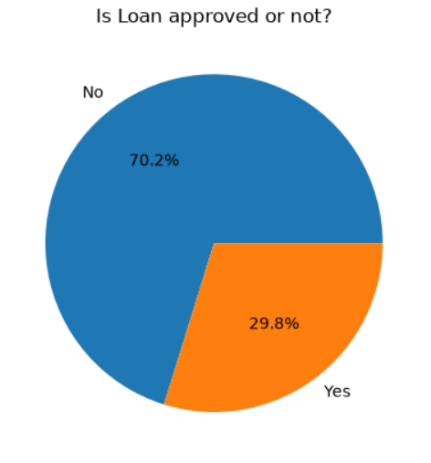
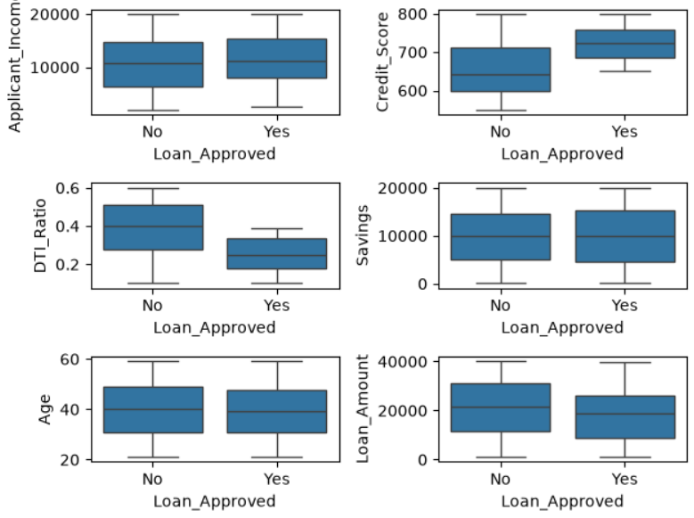
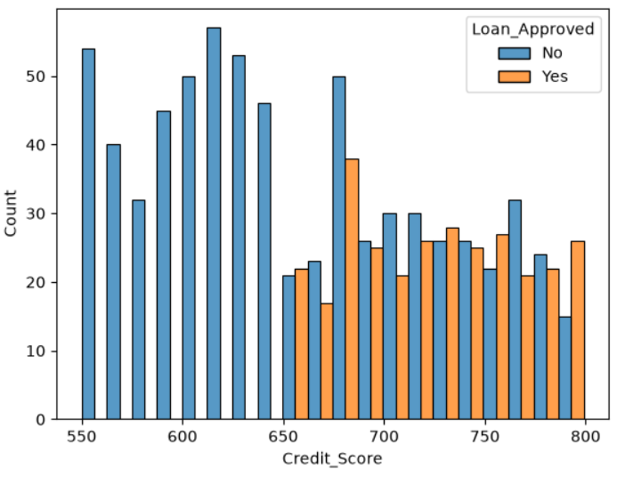
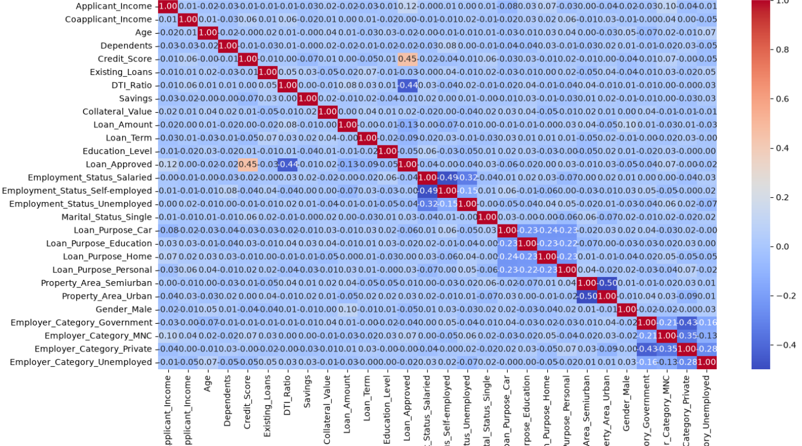
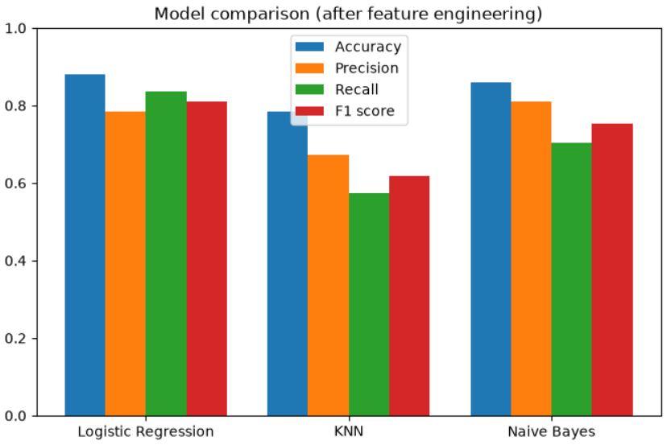
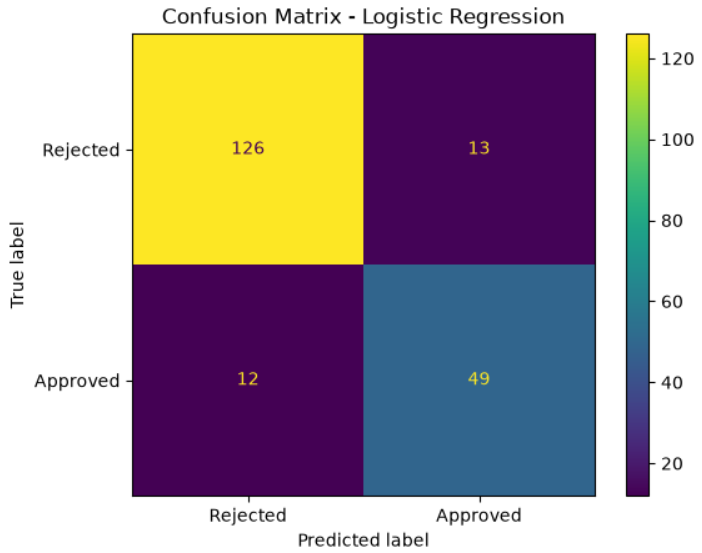

# CreditWise Loan Approval System

## Project Overview
CreditWise is a Machine Learning project that predicts whether a loan application will be approved, based on applicant details such as income, credit score, employment status, existing loans, savings and loan information.

The objective is to compare classification models and find which one predicts loan approval most reliably, which can help lenders make faster and more consistent decisions.

## Problem Statement
Manually reviewing loan applications is slow and can be inconsistent. This project builds supervised machine learning models that predict loan approval (Yes/No) from applicant and loan details.

## Dataset
- Total Records: 1,000
- Total Features: 20 columns (including the target `Loan_Approved`)
- Target: `Loan_Approved` (Yes / No)
- Class balance: 70.2% rejected, 29.8% approved
- Key features: Applicant_Income, Coapplicant_Income, Employment_Status, Age, Marital_Status, Dependents, Credit_Score, Existing_Loans, DTI_Ratio, Savings, Collateral_Value, Loan_Amount, Loan_Term, Loan_Purpose, Property_Area, Education_Level, Gender, Employer_Category
- Domain: Finance / Credit Risk
- Missing values were present in the raw data and were imputed (mean for numerical columns, most frequent value for categorical columns)

## Technologies Used
- Python
- Pandas
- NumPy
- Matplotlib
- Seaborn
- Scikit-learn

## Project Workflow
1. Data loading and understanding
2. Handling missing values (SimpleImputer: mean / most frequent)
3. Exploratory data analysis (class balance, distributions, box plots, correlation heatmap)
4. Dropping the identifier column (`Applicant_ID`)
5. Encoding: Label Encoding (`Education_Level`, target) and One-Hot Encoding for categorical features
6. Train-test split (80% train, 20% test)
7. Feature scaling with StandardScaler
8. Training and evaluating Logistic Regression, KNN and Naive Bayes
9. Feature engineering (squared `Credit_Score` and `DTI_Ratio`)
10. Re-training and comparing the models

## Visualizations

### 1. Loan Approval Class Balance

### 2. Box Plots: Income, Credit Score, DTI Ratio, Savings vs Loan Approval

### 3. Credit Score vs Loan Approval

### 4. Correlation Heatmap

### 5. Model Comparison

### 6. Confusion Matrix (Logistic Regression)

## Model Results

Test set: 200 applications (20% of the data).

**Before feature engineering**

| Model | Accuracy | Precision | Recall | F1 score |
|---|---|---|---|---|
| Logistic Regression | 0.865 | 0.783 | 0.770 | 0.777 |
| KNN (k=5) | 0.760 | 0.627 | 0.525 | 0.571 |
| Naive Bayes | 0.865 | 0.804 | 0.738 | 0.769 |

**After feature engineering** (squared `Credit_Score` and `DTI_Ratio` added, originals removed)

| Model | Accuracy | Precision | Recall | F1 score |
|---|---|---|---|---|
| Logistic Regression | 0.880 | 0.785 | 0.836 | 0.810 |
| KNN (k=5) | 0.785 | 0.673 | 0.574 | 0.619 |
| Naive Bayes | 0.860 | 0.811 | 0.705 | 0.754 |

**Final model:** Logistic Regression with engineered features.

Logistic Regression after feature engineering confusion matrix: 125 true negatives, 14 false positives, 10 false negatives, 51 true positives.

## Key Insights
- **Credit score is the strongest predictor of approval.** It has a correlation of about 0.45 with loan approval, much higher than any other feature. Applicant income is next at about 0.12, and most other features show very weak correlation.
- **Feature engineering helped Logistic Regression.** Adding squared Credit Score and DTI Ratio features raised accuracy from 0.865 to 0.880, recall from 0.770 to 0.836 and F1 from 0.777 to 0.810.
- **Logistic Regression was selected as the final model.** After feature engineering it had the best accuracy (0.880), recall (0.836) and F1 score (0.810). Naive Bayes had the highest precision (0.811) but lower recall (0.705).
- **KNN performed worst** on every metric in both rounds.
- **The dataset is imbalanced:** about 70.2% of applications were rejected and 29.8% approved, so accuracy alone can be misleading. That is why precision, recall and F1 score were also compared.

## Conclusion
This project shows the end-to-end process of a supervised classification project: cleaning, EDA, encoding, scaling, feature engineering and model comparison. Logistic Regression with engineered features was selected as the final model for its best overall balance of accuracy, recall and F1 score.

## Author
Vineet Kumar

GitHub: https://github.com/Vineet4265

LinkedIn: https://www.linkedin.com/in/vineet-kumar-b08a90239/